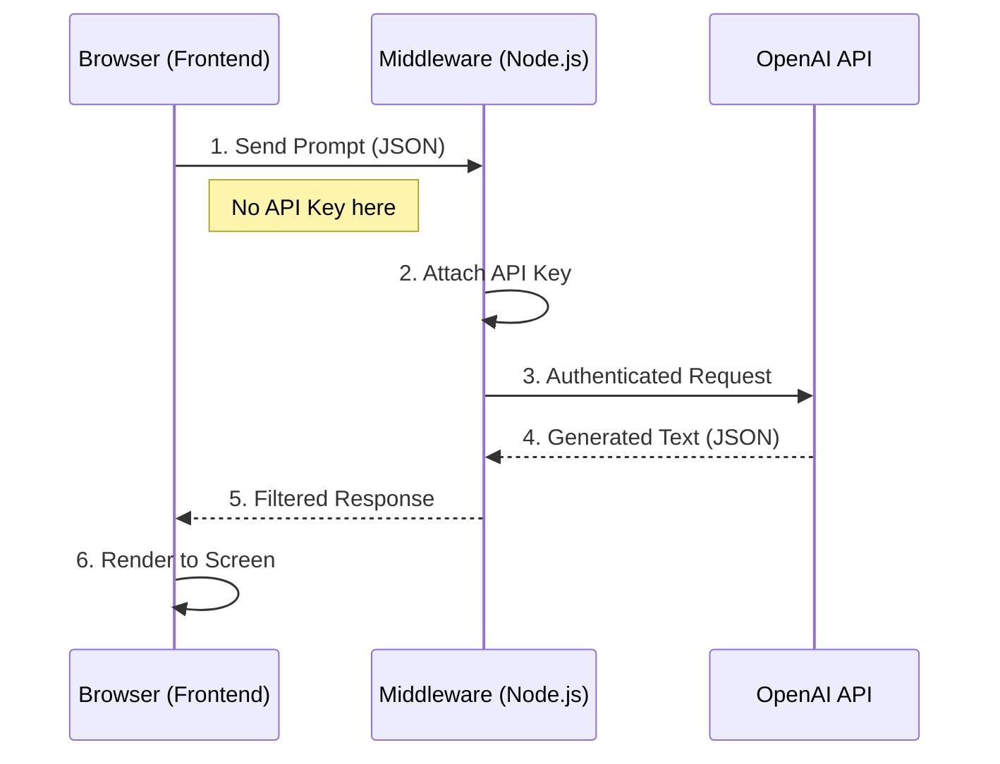

# CONNECTING TO AI AND ML APIs

**Session Time:** 120 minutes 

---

## Table of Contents

1. The Role of APIs in AI Development
2. Anatomy of an AI API Request
3. Building the Middleware Layer
4. Parsing and Rendering Model Outputs
5. Lab: Creating an AI Middleware Layer
6. Wrap-Up and Reflection
7. Resources

---

## Module Overview

In this module, learners connect web applications to external AI models and APIs, focusing on secure and efficient data transfer. While previous modules focused on setup and environment, this module dives deep into the mechanics of the HTTP request lifecycle, payload formatting, and the "middleware" pattern essential for production-grade AI applications.

---

## Learning Objectives

By the end of this module, participants will be able to:

1. **Integrate AI APIs** to securely send user input to external models.
2. **Construct** well-formed JSON payloads that control model behavior (parameters like temperature and tokens).
3. **Receive and Render** model outputs within a web application interface.
4. **Implement** a middleware layer to abstract API complexity and secure credentials.

---

## Session Breakdown

| Segment | Topic | Duration (minutes) |
| --- | --- | --- |
| 1 | The Role of APIs in AI Development | 20 |
| 2 | Anatomy of an AI API Request | 25 |
| 3 | Building the Middleware Layer | 25 |
| 4 | Parsing and Rendering Model Outputs | 20 |
| 5 | Lab: Creating an AI Middleware Layer | 30 |

---

## 1. The Role of APIs in AI Development

An Application Programming Interface (API) allows two different software systems to communicate. In the context of AI, the API acts as a gateway to a massive supercomputer hosting the Large Language Model (LLM).

### Direct vs. Indirect Connections

* **Direct Connection (Insecure):** The browser talks directly to OpenAI. This exposes your API key to anyone who views the "Network" tab.
* **Indirect Connection (Secure Middleware):** The browser talks to your server, and your server talks to OpenAI. This is the industry standard for **connecting to AI and ML APIs**.




---

## 2. Anatomy of an AI API Request

To **send** data effectively, developers must understand the structure of the HTTP request expected by the AI provider.

### Key Components of the Payload

When using the OpenAI API, the body of your POST request typically requires:

* **Model:** The specific version of the "brain" (e.g., `gpt-4o-mini`).
* **Messages:** An array of objects tracking the conversation history.
* `system`: Sets the behavior ("You are a helpful coding tutor").
* `user`: The actual input from the person.


* **Temperature:** A number (0-2) controlling randomness. Lower is more deterministic; higher is more creative.

### Example JSON Payload

```json
{
  "model": "gpt-4o-mini",
  "messages": [
    { "role": "system", "content": "You are a poetic assistant." },
    { "role": "user", "content": "Explain APIs in a rhyme." }
  ],
  "temperature": 0.7
}

```

---

## 3. Building the Middleware Layer

The **Middleware Layer** is the bridge that connects your web application to the AI API. It handles authentication, validation, and error management.

### Why Middleware?

1. **Security:** Hides the `Bearer Token`.
2. **Rate Limiting:** Prevents users from spamming the "Generate" button.
3. **Data Transformation:** You might want to simplify the complex JSON from OpenAI before sending it to your frontend.

### Implementation Logic (Node.js/Express)

The middleware receives a request from the frontend, adds the headers, calls the external API, and then forwards the result.

```javascript
// Middleware Logic
app.post('/generate', async (req, res) => {
    const userPrompt = req.body.prompt;
    
    // Connect to External AI API
    const aiResponse = await fetch('https://api.openai.com/v1/chat/completions', {
        method: 'POST',
        headers: {
            'Authorization': `Bearer ${process.env.OPENAI_API_KEY}`,
            'Content-Type': 'application/json'
        },
        body: JSON.stringify({
            model: "gpt-4o-mini",
            messages: [{ role: "user", content: userPrompt }]
        })
    });

    const data = await aiResponse.json();
    
    // Send only the necessary text back to the frontend
    res.json({ result: data.choices[0].message.content });
});

```

---

## 4. Parsing and Rendering Model Outputs

Once the middleware receives the data, the final step is to **render model outputs** in the web application.

### The Data Structure

The response from an AI API is deeply nested. Accessing the actual text usually looks like this:
`response.choices[0].message.content`

### Rendering Challenges

* **Markdown Formatting:** AI often returns bolding (`**text**`) or code blocks (`code`). If you render this as plain text, it looks messy. You often need a markdown parsing library.
* **Asynchronous Loading:** The UI must show a "Loading..." state while waiting for the `fetch` promise to resolve.

---

## 5. Lab: Creating an AI Middleware Layer

**Objective:** Build a middleware layer that connects to an AI API and displays model results.

### Prerequisites

* Node.js installed.
* Postman installed.
* An OpenAI API Key.

**Refer**: [**Creating an AI Middleware Layer**](https://git.generalassemb.ly/build-ai-powered-web-apps/Lab4_Creating-an-AI-Middleware-Layer)

---

## 6. Wrap-Up and Reflection

**Reflection Questions:**

1. Why is the middleware layer considered the "security guard" of your application?
2. If the AI returns a 500 error, how should your middleware handle that before responding to the user?

---

## 7. Resources

* [OpenAI API Reference](https://platform.openai.com/docs/api-reference)
* [Postman Learning Center](https://learning.postman.com/docs/getting-started/introduction/)
* [MDN: Fetch API](https://developer.mozilla.org/en-US/docs/Web/API/Fetch_API)